 

I'm an AI engineer and fullstack developer at [Boldare](https://www.boldare.com). I build LLM-powered products end to end: agents, RAG and MCP servers on the backend, React and Next.js on the front. I've been programming since I was a kid, and professionally since 2023.

### What I've been building

- **RAG sales & product assistant** for an industrial B2B manufacturer: streamed chat, lead capture into the CRM, LLM evals, and guardrails enforced in code, not just in the prompt.
- **Autonomous sales-inbox agent** that drafts replies to inbound leads, on top of a Gmail MCP server where sending is impossible by construction.
- **Internal CV generator** exposed as an **MCP server with OAuth 2.1**, so colleagues generate CVs straight from their AI assistant.
- **AI adoption across the company**: workshops and 1:1 sessions that move developers to coding agents (Claude Code, Codex, Cursor) and help non-technical teams build with Claude Cowork and MCP.
- **GovTech at scale**: ~3 years on large bilingual (English/Arabic, RTL) platforms in React, TypeScript, Redux and RxJS.

### Side projects

<table>
  <tr>
    <td width="50%" valign="top">
      <a href="https://github.com/jankepinski/gruntz"><b>gruntz</b></a> 
      A remake of the classic RTS as a 3D browser game: clay-style models, an authoritative multiplayer server over WebSockets, bots and a level editor. 
      TypeScript · Three.js · Preact · WebSockets · pnpm monorepo
    </td>
    <td width="50%" valign="top">
      <a href="https://github.com/jankepinski/kepisynth"><b>kepisynth</b></a> 
      A wavetable synthesizer plugin (VST3 / AU / Standalone): a C++ DSP engine on JUCE 8 with a React UI in a native WebView. 
      C++ · JUCE · React · TypeScript
    </td>
  </tr>
  <tr>
    <td width="50%" valign="top">
      <a href="https://github.com/jankepinski/neon-jump"><b>neon-jump</b></a> 
      A neon-cyberpunk jumper that lives inside VS Code and Cursor, drawn by a hand-written WebGL2 pipeline: HDR bloom, SDF shapes, CRT post-FX. No engine, zero runtime dependencies. 
      TypeScript · WebGL2 · GLSL · VS Code API
    </td>
    <td width="50%" valign="top">
      <a href="https://github.com/jankepinski/kepi-code"><b>kepi-code</b></a> 
      An experimental coding-agent CLI with exactly one built-in tool: <code>bash</code>. Sessions, auto-compaction, skills and MCP servers on top. 
      TypeScript · Ink · Vercel AI SDK · OpenRouter · MCP
    </td>
  </tr>
  <tr>
    <td width="50%" valign="top">
      <a href="https://github.com/jankepinski/hexagonal-newsletter-template"><b>hexagonal-newsletter-template</b></a> 
      A newsletter boilerplate in hexagonal architecture: double opt-in with GDPR consent, a job queue with retries, pluggable mailers and contract tests for every adapter. 
      Next.js · PostgreSQL · Drizzle · pg-boss · Resend
    </td>
    <td width="50%" valign="top">
      <a href="https://github.com/jankepinski/pixel-perfect"><b>pixel-perfect</b></a> 
      An AI pixel-art generator: Gemini creates the sprite, then grid detection, background removal and an editor turn it into a clean 1:1 asset. 
      Next.js · Gemini API · Tailwind CSS · shadcn/ui
    </td>
  </tr>
</table>

### Writing

- [Can AI build an application from scratch?](https://www.linkedin.com/pulse/can-ai-build-application-from-scratch-our-front-end-developer-bagvf/): I let Claude Opus 4.5 build a puzzle game from scratch ([play it](https://crypto-game-opus-4-5.netlify.app/)).
- [How AI and Figma MCP changed the way I build frontend in large-scale projects](https://www.boldare.com/blog/how-ai-and-figma-mcp-changed-the-way-I-build-frontend-in-large-scale-projects/), on the Boldare blog.

### Toolbox

**AI:** Vercel AI SDK · OpenAI API · LLM pipelines · RAG · tool calling · evals · MCP · Claude Code · Codex · Cursor 
**Frontend:** TypeScript · React · Next.js · Redux Toolkit · RxJS · Tailwind CSS · shadcn/ui · Three.js 
**Backend:** Node.js · NestJS · Hono · PostgreSQL · Drizzle · Docker · Helm

 

  <a href="https://www.linkedin.com/in/kepinski-dev/">LinkedIn</a> · <a href="mailto:kepinski.dev@gmail.com">kepinski.dev@gmail.com</a>

